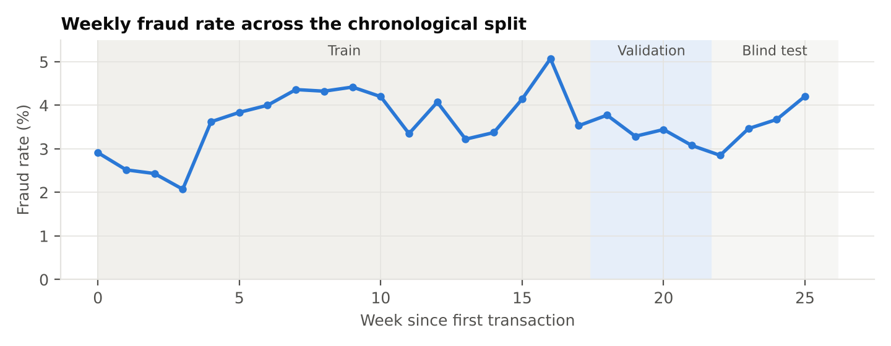
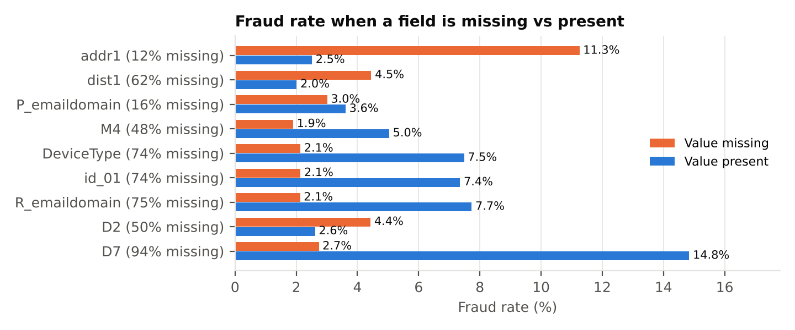
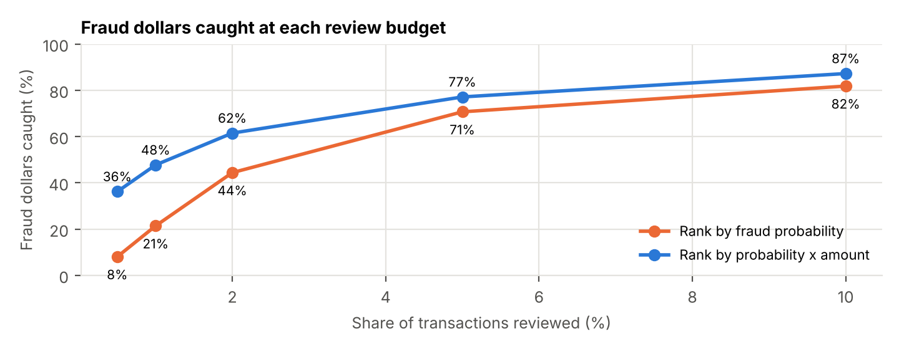
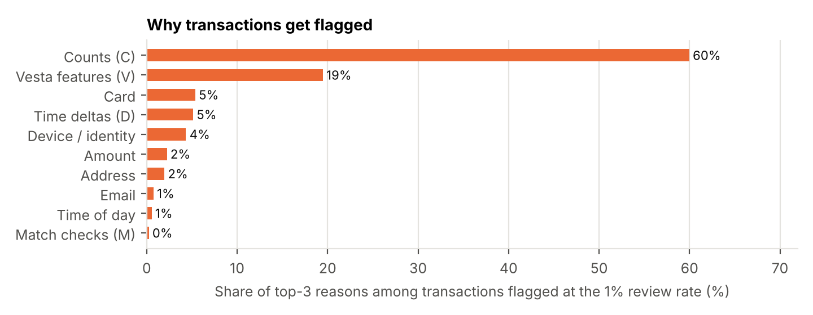

# Online Payment Fraud Detection Using High-Dimensional Transaction Data

**Banking-1A** · Break Through Tech AI Studio, Fall 2026 · Host company: **Mastercard**

We're building a fraud-risk model for card-not-present (online) payments on the IEEE-CIS dataset. It ranks transactions so a fraud team with a fixed daily review budget catches as much fraud, and as many fraud dollars, as possible, and it explains why each transaction was flagged.

📄 **Progress report (PDF):** [`docs/reports/progress_report_oct2026.pdf`](docs/reports/progress_report_oct2026.pdf) · Milestone 1 EDA report: [`docs/reports/milestone1_eda_and_baselines.pdf`](docs/reports/milestone1_eda_and_baselines.pdf)

---

## 👥 Team Members

| Name | GitHub Handle | Contribution |
|---|---|---|
| Mohit Unecha | [@MohitUnecha](https://github.com/MohitUnecha) | Business objective and evaluation framework, literature review, GitHub board and issues, XGBoost baseline and tuning, deep learning literature review, MLP baseline, SHAP attribution, threshold calibration, milestone write-ups |
| Leonel Andrade | [@leoAndrade2332](https://github.com/leoAndrade2332) | Repo skeleton, Kaggle download script, canonical merged dataset, chronological split, October board and ensemble |
| Orator Murambiwa | [@OratorMurambiwa](https://github.com/OratorMurambiwa) | Categorical encoding, customer-ID feasibility, LightGBM baseline and tuning, second deep learning model |
| Refilwe Pitso | [@WCMREFILWE](https://github.com/WCMREFILWE) | Shared evaluation module, dollar-capture metrics, logistic regression and random forest baselines, drift re-check |
| Faizah | _add handle_ | Missing-value and categorical EDA, class imbalance and drift analysis, CatBoost baseline and tuning |
| Nicholas | _add handle_ | Module contracts, results registry, literature review |
| Emily | _add handle_ | Error analysis, customer-history (temporal) features, results dashboard |

**AI Studio Coach:** Harshini Donepudi ([@HarshiniDonepudi](https://github.com/HarshiniDonepudi)) · **Challenge Advisor:** Debasmita Das, Mastercard ([@StarkArya30](https://github.com/StarkArya30))

---

## 🎯 Project Highlights

- Built a **reproducible pipeline** on 590,540 real transactions: integrity-checked download, merged Parquet, and a **frozen chronological split** (train 420,066 / validation 85,044 / blind test 85,430), so every model is tested on later transactions than it learned from.
- **Tuned XGBoost reaches validation AUPRC 0.682 ± 0.0005** over 3 seeds (random guessing = 0.034, raw-feature baseline = 0.620). Reviewing the riskiest 5% of transactions catches **71% of fraud**.
- **Ranking by expected loss** (calibrated probability × amount) catches **48% of fraud dollars instead of 21%** at the same 1% daily review budget (about 28 reviews a day). That's about $226k vs $110k saved over 30 days under our placeholder cost assumptions.
- **Explained the model with TreeSHAP:** link counts (cards, addresses and accounts tied to a payment) drive 60% of the reasons transactions get flagged. Missed fraud is mostly product-W web purchases without identity data.
- Benchmarked **deep learning** against trees. The first MLP (focal loss, AUPRC 0.536) trails boosted trees, as the literature predicts. The second architecture is FT-Transformer.

---

## 👩🏽‍💻 Setup and Installation

### Setup
1. Clone the repo and open the folder in VS Code.
2. Create and activate a venv: `python -m venv .venv`, then `.venv\Scripts\Activate.ps1` (Mac/Linux: `source .venv/bin/activate`).
3. `pip install -r requirements.txt` then `pip install -e .`
   (For a smaller PyTorch install on CPU: `pip install torch --index-url https://download.pytorch.org/whl/cpu`.)
4. Set `KAGGLE_API_TOKEN` (see `.env.example`). Python version used: 3.13.5
5. Run the tests: `pytest -q` (synthetic data, no download needed).

### Repo layout
- `scripts/`: runnable programs (data download, dataset build, split, analysis)
- `src/fraud/`: shared importable code (`split`, `explain`, `thresholds`, `models/`)
- `splits/`: frozen split ID files (never regenerate)
- `results/`: experiment registry (`registry.jsonl`) and run summaries
- `notebooks/<name>/`: personal exploration
- `tests/`: automated checks
- `docs/`: write-ups, figures and PDF reports

### Team etiquette
- No data in the repo. The Parquet file lives in the shared Drive folder.
- Work on a branch, open a PR, and get one teammate review before merging.
- Shared code lives in `src/`, not notebooks.

### Getting the data
1. Accept the competition rules: https://www.kaggle.com/competitions/ieee-fraud-detection/rules
2. Generate a token at https://www.kaggle.com/settings/api and set it as `KAGGLE_API_TOKEN`
   (Windows: `setx KAGGLE_API_TOKEN "your_token"`, then fully restart VS Code).
3. Run `python scripts/setup_data.py`

Files land in `data/raw/` (ignored by Git). The script stops with an ERROR if anything is missing or doesn't match `scripts/data_manifest.json`.

**Colab:** add the token in the Secrets panel (key icon) as `KAGGLE_API_TOKEN`, then run:
```python
import os
from google.colab import userdata
os.environ["KAGGLE_API_TOKEN"] = userdata.get("KAGGLE_API_TOKEN")
```

### Getting the merged dataset
Download `train_merged_v1.parquet` from the team Google Drive folder into this repo's `data/` folder, then load it as described in `docs/DATA.md`. To rebuild it from the raw Kaggle files instead, run `python scripts/setup_data.py`, then `python scripts/build_dataset.py` (a few minutes).

### Reproducing the main results
```bash
python -m fraud.models.xgboost_baseline --feature-set fe_v2 --learning-rate 0.1      # Sept #19 baseline
python -m fraud.models.xgboost_tuning --trials 60 --report-dir reports/xgboost_tuned # Oct #8 (about 3 h on 2 CPUs)
python scripts/analyze_tuned_xgboost.py --model-dir reports/xgboost_tuned --out reports/oct_analysis  # Oct #18, #19
python -m fraud.models.mlp_baseline --loss focal                                     # Oct #14
```

---

## 🏗️ Project Overview

This project is part of the **Break Through Tech AI Program's AI Studio**, where teams of fellows work on a real business problem with a host company. Our host is **Mastercard**, and our Challenge Advisor is Debasmita Das.

**Objective:** stop fraudulent online payments before they settle, without blocking so many legitimate customers that it hurts revenue and trust. Concretely, rank transactions so a fraud operations team with a fixed review capacity (1% or 5% of daily volume) catches the most fraud and fraud dollars, while keeping the false-positive rate under 1% ([`docs/business_objective.md`](docs/business_objective.md)).

**Scope by milestone:** September covers data understanding, preparation and baselines. October covers tuning, deep neural networks and explainability. November covers evaluation on the blind test, robustness, explainability and a prototype that returns a fraud score with reasons.

**Why it matters:** card-not-present fraud is the largest share of card fraud losses. Every missed fraud costs the transaction amount plus chargeback fees, and every false alarm costs analyst time and customer goodwill. A model that ranks by money at risk lets a small team protect more dollars with the same effort.

---

## 📊 Data Exploration

**Dataset:** [IEEE-CIS Fraud Detection](https://www.kaggle.com/c/ieee-fraud-detection) (Vesta, via Kaggle). 590,540 labeled transactions over about 6 months, with 20,663 frauds (3.5%), across 394 transaction and 41 identity columns. Most columns are anonymized (V1–V339, C1–C14, D1–D15, M1–M9, id_01–id_38). The merged Parquet file is 84 MB and about 1 GB in memory.

**Preparation:** we left-joined identity onto transactions (only 24% have an identity record) with a `has_identity` flag, stored the data in memory-efficient types, and split it chronologically by day (train days 0–121, validation 122–151, blind test 152–182).

**Key EDA findings** (full write-ups: [`docs/literature_review.md`](docs/literature_review.md), [Milestone 1 PDF](docs/reports/milestone1_eda_and_baselines.pdf)):
- **The fraud rate drifts**: 2.5% in the first month, 3.4% to 4.4% after. Twenty features shift strongly over time, led by browser version (id_31).
- **Missingness is informative**: a missing billing address goes with an 11.3% fraud rate vs 2.5%, and the V columns fall into 14 shared-missingness blocks.
- **High-cardinality categories**: card1 has 12,295 values and DeviceInfo 1,556, so we use frequency encoding or native categorical handling.
- **Customer ID can be rebuilt** (card1 + addr1 + day − D1, which matches D3 95% of the time). Fraud labels spread across a customer's transactions, a leakage risk we control with time-based splits and past-only features.





---

## 🧠 Model Development

| Model | Notes |
|---|---|
| XGBoost (`fe_v2`) | Raw features plus train-only frequency encodings, normalized D columns, hour and amount features. Native categorical splits |
| XGBoost tuned | Optuna TPE, 60 trials on a 150k-row sample, median pruning, refit on all training rows over 3 seeds ([write-up](docs/xgboost_tuning_results.md)) |
| LightGBM | Native categorical baseline and Optuna tuning (Orator) |
| MLP | Categorical embeddings, quantile-normalized numerics, missing-pattern flags, focal loss vs weighted BCE ([write-up](docs/mlp_baseline_results.md)) |
| In progress | CatBoost, logistic regression and random forest, FT-Transformer, ensemble |

**Training setup:** frozen chronological split (`splits/`, id `chrono-v1-c3eab22dc2`); early stopping and model choice on validation; the blind test is sealed until November.

**Metrics:** AUPRC first, then fraud caught at 1% and 5% review rates, fraud-dollar capture, precision, recall, false-positive rate and KS. ROC-AUC is reported second because it looks strong on imbalanced data. Every run is logged to `results/registry.jsonl`.

---

## 📈 Results & Key Findings

| Model (validation split) | AUPRC | ROC-AUC | Fraud caught, top 1% | Fraud caught, top 5% |
|---|---|---|---|---|
| **XGBoost tuned (3 seeds)** | **0.682 ± 0.001** | **0.935** | 28.2% | **71.2%** |
| LightGBM tuned | 0.668 | | 28.1% | 69.8% |
| XGBoost `fe_v2` | 0.664 | 0.913 | 28.2% | 69.8% |
| XGBoost raw features | 0.620 | 0.917 | 27.8% | 65.8% |
| MLP, focal loss (3 seeds) | 0.536 ± 0.008 | 0.906 | 25.2% | 60.1% |

At a 1% review rate the ceiling is 29.5% (851 reviews, 2,884 frauds), so the 5% column separates the models better.

**Operating point** ([`docs/threshold_calibration.md`](docs/threshold_calibration.md)):



**Explainability** ([`docs/shap_attribution.md`](docs/shap_attribution.md)):



**Fairness note:** the dataset has no demographic fields. We check performance by segment (product, card type, has_identity) instead, and that is part of the November robustness work.

---

## 🚀 Next Steps

- **Limitations:**
  - Validation was used for tuning and thresholds, so its scores are slightly optimistic.
  - Real chargebacks arrive weeks late.
  - 24% of model influence comes from anonymized V features.
  - Costs ($20 chargeback, $5 review) are placeholders awaiting advisor sign-off.
- **November:**
  - Score the finalists once on the blind test.
  - Check robustness by week and segment.
  - Add customer-history features if they add at least 0.01 AUPRC.
  - Build reason codes from SHAP families.
  - Build a small API or dashboard prototype.
- **With more time or compute:** periodic numerical embeddings for the MLP on a GPU, FT-Transformer on reduced features, sequence models over each customer's earlier transactions, and an ensemble of trees and deep models.

---

## 📝 License

_To be chosen with our Challenge Advisor (for example, MIT)._ The IEEE-CIS data is subject to the [Kaggle competition rules](https://www.kaggle.com/competitions/ieee-fraud-detection/rules) and isn't redistributed in this repo.

---

## 📄 References

- Vesta / Kaggle. *IEEE-CIS Fraud Detection* dataset and data description. https://www.kaggle.com/c/ieee-fraud-detection · https://www.kaggle.com/c/ieee-fraud-detection/discussion/101203
- Deotte, C. and Yakovlev, K. *1st Place Solution, Part 2.* Kaggle. https://www.kaggle.com/competitions/ieee-fraud-detection/writeups/fraudsquad-1st-place-solution-part-2
- NVIDIA Technical Blog. *Leveraging Machine Learning to Detect Fraud: Tips to Developing a Winning Kaggle Solution.* https://developer.nvidia.com/blog/leveraging-machine-learning-to-detect-fraud-tips-to-developing-a-winning-kaggle-solution/
- Arun M. *IEEE-CIS Fraud Detection: Top 5% Solution.* Towards Data Science. https://towardsdatascience.com/ieee-cis-fraud-detection-top-5-solution-5488fc66e95f/
- *IEEE-CIS local benchmark with magic-UID ablation.* https://github.com/Edgar100800/ieee-cis-fraud-detection-local-benchmark
- Mishra, P. *A realistic approach to Kaggle's IEEE-CIS Fraud Detection Challenge.* https://medium.com/@mr.priyankmishra/a-realistic-approach-to-ieee-cis-fraud-detection-25faea54137
- Shwartz-Ziv, R. and Armon, A. *Tabular Data: Deep Learning is Not All You Need.* 2022. https://arxiv.org/abs/2106.03253
- Grinsztajn, L., Oyallon, E. and Varoquaux, G. *Why do tree-based models still outperform deep learning on tabular data?* NeurIPS 2022. https://arxiv.org/abs/2207.08815
- Gorishniy, Y. et al. *Revisiting Deep Learning Models for Tabular Data.* NeurIPS 2021. https://arxiv.org/abs/2106.11959
- Gorishniy, Y., Rubachev, I. and Babenko, A. *On Embeddings for Numerical Features in Tabular Deep Learning.* NeurIPS 2022. https://arxiv.org/abs/2203.05556
- Arik, S. O. and Pfister, T. *TabNet: Attentive Interpretable Tabular Learning.* AAAI 2021. https://ojs.aaai.org/index.php/AAAI/article/view/16826
- Somepalli, G. et al. *SAINT: Improved Neural Networks for Tabular Data via Row Attention and Contrastive Pre-Training.* 2021. https://arxiv.org/abs/2106.01342
- *Interpretable versus Learned Encoders for High-Cardinality Fraud Detection.* 2026. https://arxiv.org/html/2607.00477
- Lin, T.-Y. et al. *Focal Loss for Dense Object Detection.* ICCV 2017. https://arxiv.org/abs/1708.02002
- Chen, T. and Guestrin, C. *XGBoost: A Scalable Tree Boosting System.* KDD 2016. https://arxiv.org/abs/1603.02754
- Akiba, T. et al. *Optuna: A Next-generation Hyperparameter Optimization Framework.* KDD 2019. https://arxiv.org/abs/1907.10902
- Lundberg, S. M. et al. *From local explanations to global understanding with explainable AI for trees.* Nature Machine Intelligence, 2020. https://arxiv.org/abs/1905.04610

---

## 🙏 Acknowledgements

Thank you to our Challenge Advisor **Debasmita Das** (Mastercard), our AI Studio Coach **Harshini Donepudi**, and the Break Through Tech AI team, including **Dr. Uohna June Thiessen** and **Hari Raghavan**, for their guidance and support.
