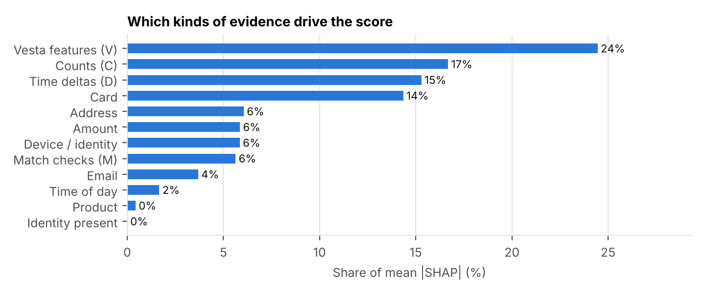
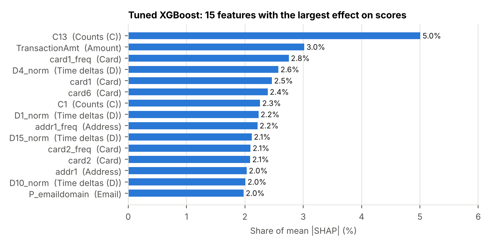

# SHAP Feature Attribution for Tuned XGBoost (October Task #18)

Owner: Mohit · Model: tuned XGBoost from Task #8 (seed 42, validation AUPRC 0.682) · Validation split only

## Method

- **Exact TreeSHAP** from XGBoost itself (`pred_contribs=True`). Each SHAP value is one feature's push on one transaction's log-odds of fraud. A transaction's values plus a bias term add up to its raw score; we checked this on every row analyzed.
- **Rows analyzed (12,925):** all 2,884 validation frauds, the 851 transactions the model would send to review at the 1% rate, and a random 10,000 legitimate transactions. Legitimate rows are re-weighted to their real share, so global numbers describe the whole validation month.
- Features are grouped into families with a plain-language meaning (`fraud.explain.FAMILIES`). Most columns are anonymized by Vesta, so these meanings follow the Kaggle data description and our EDA, not official definitions.
- Code: `python scripts/analyze_tuned_xgboost.py --model-dir <tuned model> --out <dir>`

## 1. What drives the score overall

| Family | Share of total effect | What it means for the business |
|---|---|---|
| Vesta features (V, 339 cols) | 24% | Engineered counts and relationships. Strong, but hard to explain to an analyst |
| Counts (C, 14 cols) | 17% | How many cards, addresses or accounts are linked to the payment, a velocity signal |
| Time deltas (D, 15 cols) | 15% | How long since the card or account was first or last seen. New and dormant cards are riskier |
| Card (10 cols) | 14% | Issuer and type group, and how common the card group is |
| Address, Amount, Device/identity, Match checks | 6% each | Billing region, spend size, device fingerprint, name/address match flags |
| Email | 4% | Purchaser and recipient providers |
| Time of day | 2% | Hour of the transaction |

**About 75% of the model's evidence comes from families an analyst can describe** (C counts, D time deltas, card, address, amount, device, match checks, email, time of day). The other 24% sits in Vesta's anonymized V columns, the main limit on explainability for Mastercard.

The single most influential feature is **C13** (5% of the total effect), a Vesta count of entities linked to the payment. Next come **TransactionAmt**, **card1_freq** (how common the card group is) and **D4_norm** (normalized days since an earlier event). Seven of the top 15 features are ones we added in September (card1_freq, card2_freq, addr1_freq, and normalized D4, D1, D15 and D10), which confirms that the fe_v2 work moved the model.

## 2. Why transactions get flagged

For each of the 851 transactions flagged at the 1% review rate, we took the three features pushing hardest toward fraud.

- **Counts (C) make up 60% of flag reasons.** The most common single reasons are C1 (21% of reasons), C11 (17%), V258 (13%), C13 (8%) and C14 (5%).
- **For an analyst, the typical alert reads "this payment is linked to an unusually large number of cards, addresses or accounts".** That is a velocity pattern, which matches how card-testing and account-takeover fraud behave.
- Card, time-delta and device evidence each account for about 5% of reasons. The flags rarely rest on amount, address or email alone.

Business tie-in (business objective, section 1): the model's alerts at the 28-a-day review budget are dominated by **linkage/velocity evidence**. Reason codes for a review queue can start with three plain-language templates: "many linked cards/accounts" (C), "new or dormant card" (D), "unusual device or browser" (device/identity).

## 3. What the model misses

Frauds outside the top 5% (837 of 2,884, worth $134,801):

| | Caught in top 5% | Missed at 5% |
|---|---|---|
| Count | 2,047 | 837 |
| Median amount | $73.53 | $77.95 |
| Have an identity record | 59% | **27%** |
| Most common product | C | **W** |

- **Missed fraud looks like ordinary web purchases (product W) with no identity or device data.** Without the identity record, the model loses its device fingerprint evidence. Missing identity data is normal for product W, which is 72% of all traffic.
- On missed frauds, the C counts and V features push **less** toward fraud than on caught frauds (mean SHAP lower by 2.4 and 2.1 log-odds). The linkage signal that catches most fraud is simply absent.
- **What could help:** customer-history features (Emily, #16). A W purchase with no identity can still be compared to the same card's earlier transactions. This is also the starting point for Emily's error analysis (#13).

## 4. Caveats

- SHAP explains the model, not the world. A high C13 effect means the model relies on C13, not that C13 causes fraud.
- Correlated features share credit. Many V columns are near-duplicates, so the V family's 24% is spread thinly across many columns.
- Attribution covers only the validation month (days 122 to 151). The November robustness work should check whether the drivers change across months.

## Files

- `results/oct_analysis/shap_global_importance.csv`, `shap_family_importance.csv`
- `results/oct_analysis/reasons_flagged_by_family.csv`, `reasons_flagged_by_feature.csv`
- `results/oct_analysis/missed_vs_caught.csv`, `missed_vs_caught_by_family.csv`
- Figures in `docs/figures/october/`
