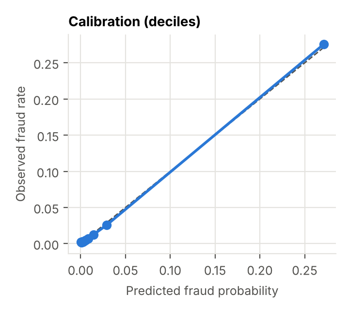

# Threshold Calibration Against the Review Budget (October Task #19)

Owner: Mohit · Model: tuned XGBoost (Task #8, seed 42) · Validation split: 85,044 transactions over 30 days, 2,884 frauds worth $459,845

Builds on the business framework (Sept #13) and the dollar-capture table (Sept #12). The cost figures are the placeholders from the business objective, which the Challenge Advisor still needs to confirm: a missed fraud costs its amount plus a $20 chargeback fee, and each review costs $5.

## Recommendation

| Review budget | Rank transactions by | Threshold | Reviews a day | Precision | Fraud caught (cases) | Fraud caught (dollars) | Legit customers flagged | Net savings over 30 days |
|---|---|---|---|---|---|---|---|---|
| **1%** (primary) | **expected loss** | expected loss ≥ **$107** | 28 | 65% | 19% | **48%** ($219.5k) | 0.36% | **$226k** |
| 1% | fraud probability | probability ≥ 0.91 | 28 | 95% | 28% | 21% ($98.5k) | 0.05% | $110k |
| **5%** (secondary) | **expected loss** | expected loss ≥ **$22** | 142 | 43% | 64% | **77%** ($354.6k) | 2.9% | **$370k** |
| 5% | fraud probability | probability ≥ 0.11 | 142 | 48% | 71% | 71% ($325.1k) | 2.7% | $345k |

**Expected loss = calibrated fraud probability × (amount + $20 fee).** It's the dollar amount we expect to lose if the transaction goes through unreviewed.

**At the primary 1% budget, ranking by expected loss more than doubles the fraud dollars caught (48% vs 21%) and the net savings ($226k vs $110k a month), using the same 28 reviews a day.** The trade-off: analysts see fewer, larger frauds (precision 65% instead of 95%, and 19% of fraud cases instead of 28%), and 0.36% of legitimate customers get a review instead of 0.05%. Both stay well inside our 1% customer-friction limit.

Which ranking to use is a business choice. The challenge brief stresses fraud dollar capture, so we recommend expected loss as the default and probability ranking as the option if the fraud team is measured on case counts.

## How it works

1. **Calibrate the scores.** XGBoost was trained with class weighting, so raw scores overstate fraud risk. We fit Platt scaling (a logistic map on the score's log-odds) on the first half of the validation window and apply it to the second half, then the reverse. No transaction is calibrated by a fit that saw it. Calibration is monotone, so it never changes ranking by probability.

   After calibration, predicted and observed fraud rates agree in every decile: the top decile predicts 27.1% and observes 27.6%. The textbook correction for class weighting (divide the odds by the weight) made the probabilities far too low on our data (2 times too low in the top decile and over 1,000 times in the bottom deciles), so we don't use it (`calibration_prior_correction.csv`).

   

2. **Fill the review budget.** For a review rate *r*, flag the top *r* share of transactions by the chosen ranking. The threshold is the score of the last flagged transaction.

3. **Cost everything.** Total cost = (amount + $20) for every missed fraud + $5 per review. Without a model, all $517.5k of fraud cost is lost.

## Are the thresholds stable?

The same procedure was run separately on each half of the validation month:

| Ranking | Budget | Threshold, first half | Threshold, second half | Fraud dollars caught, first → second half |
|---|---|---|---|---|
| Expected loss | 1% | $107 | $106 | 52% → 43% |
| Expected loss | 5% | $22.9 | $22.1 | 83% → 71% |
| Probability | 1% | 0.95 | 0.85 | 21% → 22% |
| Probability | 5% | 0.112 | 0.115 | 76% → 65% |

- **The expected-loss thresholds barely move** ($106 to $107 at 1%), so a fixed dollar threshold is a practical operating rule.
- **Performance drops within a single month**, from 83% to 71% of fraud dollars at 5%. That is the drift we saw in September, and it is the main input to Refilwe's drift re-check (#20) and the November robustness work.
- **Operate by daily review count, not a frozen threshold,** and re-calibrate monthly. A fixed count keeps analyst workload steady even when scores shift.

## Is the review budget the right size?

With a $5 review cost, total cost keeps falling up to a 10% review rate: reviews are cheap compared with the average missed fraud ($159 plus fee). So **analyst capacity, not cost, is the real limit.** The 1% and 5% budgets are capacity assumptions, and they need sign-off from the Challenge Advisor.

| Cost per review | Cheapest review rate tested | Net savings over 30 days |
|---|---|---|
| $2 | 20% | $450k |
| $5 | 10% | $403k |
| $10 | 10% | $360k |
| $25 | 5% | $285k |

## Caveats

- Thresholds and calibration were chosen on validation. They must be re-checked once on the blind test in November.
- The cost figures are placeholders. Changing them changes the dollar results but not the conclusion that expected-loss ranking catches more dollars at a fixed budget.
- Ranking by expected loss favors large transactions. Small card-testing frauds, which often come before a big fraud, get reviewed less. A mixed queue (for example, 80% of slots by expected loss and 20% by probability) is worth testing in November.

## Files

- `src/fraud/thresholds.py` (calibration, operating points, cost model, stability), tests in `tests/test_thresholds.py`
- `results/oct_analysis/operating_points.csv`, `calibration.csv`, `threshold_stability*.csv`, `cost_sensitivity.csv`
